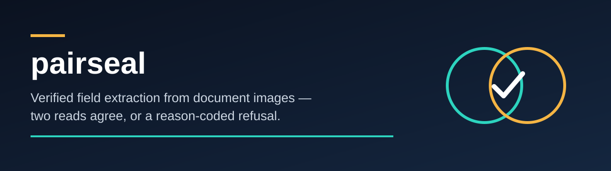

# pairseal

**Verified field extraction from document images — free, with your own model keys.**

Send pairseal a photo or scan of an invoice, a bank check, a receipt, a retail flyer, a shelf label, or a form, and it returns the fields and line items that **two independent vision-model reads agree on** — sealed, with the model pair recorded. Everything the two reads cannot agree on comes back as a **reason-coded refusal**, never as a guess.

Commercial document-extraction APIs charge roughly $0.08–0.30 per document for receipts and invoices, and their catalogues stop there: no flyer product, no agreement gate, no refusal semantics, no validity windows. pairseal is the free, multipurpose alternative: it runs entirely with **your own provider keys** (free tiers work), and images go only to the providers you configure.

## Why a gate, not just an extractor

Vision models read images well. What they do not do is tell you when they have misread one — and in a price or amount field, a misread is not a typo, it is a wrong number served as fact. pairseal's answer is structural:

1. **Two different vision models read the same image**, in separate calls, with the identical prompt.
2. **A deterministic reconciler compares the reads** field by field and item by item — normalised values, exact to the cent for money. No third model judges; agreement is computed.
3. **Only agreement is sealed.** A field or item seen by one read, read differently by the two, or printed in a format that cannot be resolved uniquely is refused with a reason code.
4. **Document-level cross-checks run on top.** A bank check whose numeric amount and written amount disagree is refused *even when both models agree with each other* — the document contradicts itself. A flyer price inside a printed validity window that has ended is refused as expired, however cleanly it was read.

A refusal is a success state of this tool, not an error. The gate may refuse a truth; it never invents one.

## Document types

| Type | Fields sealed on agreement | Items | Document-level checks |
|---|---|---|---|
| `invoice` | vendor, invoice_number, invoice_date, tax, total | line items (description, qty, amount) | — |
| `check` | payee, check_date, amount_numeric, amount_written, routing_number, account_number, memo | — | **numeric vs written amount cross-check** |
| `receipt` | merchant, receipt_date, total | items (name, qty, price) | — |
| `flyer` | — (validity window recorded) | products (name, price, unit, qty) | **validity-window expiry gate** |
| `generic` | your field names (`--fields member_id,visit_date,…`) | — | — |

Document type is user-specified (`--doc-type`) or auto-detected from the reads. Field kinds are compared by kind: money in integer cents, dates as calendar dates, text on a normalised token key.

Money formats are resolved from the text **as printed**, because that is where ambiguity lives: `5.99`, `$5 99`, and `5/99` resolve; a bare `599` does not ($599, $5.99, and 599 cents are all live readings) and is refused as `ambiguous_price_format`.

## Refusal taxonomy

| Reason | Meaning |
|---|---|
| `models_disagree` | both reads saw the item but conflict on price, unit, or quantity |
| `field_conflict` | both reads extracted the field but the normalised values conflict |
| `cross_field_mismatch` | two sealed values inside the document contradict each other (check amounts) |
| `single_read_only` | only one read saw the field/item |
| `unreadable` | a read could not read the image, or its reply was unusable |
| `no_price_found` | the reads were usable but nothing extractable was found |
| `ambiguous_price_format` | the printed money value cannot be resolved to a unique value |
| `expired_window` | the agreed price sits inside a printed validity window that has ended |
| `provider_error` | a provider call failed (HTTP status recorded); a 429 is a hard stop for that provider in that run — recorded, never retried in a loop |
| `image_unavailable` | the image bytes could not be obtained (collector-level; the gate itself never emits it) |

## Privacy

pairseal runs with **your** keys; images go only to the providers **you** configure. Nothing is sent anywhere else, and there is no pairseal server.

Corpus logs follow a strict rule for sensitive fields — bank-check amounts and account/routing numbers, and any field whose name mentions account, routing, ssn, or card: the log stores the field **name**, the **agreement outcome**, and the **image hash** only. Never the extracted value, and never raw read text that contains it. Check records are value-free by construction; the self-test verifies this on every run.

## Providers and the pair

Readers are pluggable. A run names its pair explicitly, and every output record carries the pair's identity — provider, family, and the exact requested *and* API-reported model ids for both readers — plus a distance class: `cross_provider`, `same_provider_cross_family`, `same_family`, or `single_reader`.

- **Gemini** via Google AI Studio (`gemini:<model>`) — Interactions API.
- **Groq** vision models (`groq:<model>`) — OpenAI-compatible chat completions. Note: some Groq keys' catalogues carry no vision model; the reader reports `model_not_found` honestly when so.
- **OCR baseline** (`ocr`) — a local `tesseract` binary when installed; a deliberately simple heuristic line parse, kept as a measured baseline. It is not recommended as a gate reader: classical OCR garbles flyer digits (`599 99 99`), which is the failure this tool exists to refuse rather than repeat.

Credentials are never read from files or arguments and never printed: inside Muse they come from the connector credential store; standalone, from the standard environment variables (`GEMINI_API_KEY` / `GOOGLE_AI_STUDIO_API_KEY` / `GROQ_API_KEY`).

**Honest limit — agreement is not independence.** Two models can be wrong together: published measurement (Kim et al., *Correlated Errors in Large Language Models*, ICML 2025) found that when two LLMs are both wrong they agree on the same wrong answer far above chance, and that same-developer pairs correlate the most. A `same_provider_cross_family` pair — two model families behind one provider's API — is a weaker gate than a cross-provider pair, and the record says which one you ran. Treat sealed output as *verified by agreement*, with the strength the pair metadata states — not as ground truth.

## Install

```bash
pip install .            # core: Python >= 3.10, standard library only
pip install .[selftest]  # + Pillow, for the synthetic-fixture self-test
```

## Use

```bash
# auto-detect the document type, default pair, append to a corpus log
pairseal extract invoice.png --corpus corpus.jsonl

# name the type and the pair explicitly
pairseal extract check.jpg --doc-type check \
    --reader gemini:gemini-3.5-flash --reader gemini:gemma-4-31b-it

# generic form with your own fields
pairseal extract form.png --doc-type generic --fields member_id,visit_date

# inspect a corpus log
pairseal verify-corpus corpus.jsonl
```

Exit codes: `0` — at least one field or item sealed; `3` — the gate refused everything (a success state of the gate, distinct from failure); `2` — usage/config error.

As a library:

```python
from pairseal import extract, make_reader

record = extract(
    open("flyer.jpg", "rb").read(),
    readers=[make_reader("gemini:gemini-3.5-flash"),
             make_reader("gemini:gemma-4-31b-it")],
    doc_type="flyer",
    source={"url": "https://example.com/flyer", "retailer": "Example Mart",
            "posted_at": None, "note": None},
)
print(record["tuples"])    # sealed items only
print(record["refusals"])  # everything else, reason-coded
```

## Corpus log

Every run produces one JSON record (schema 1.1, documented in [docs/corpus-schema.md](docs/corpus-schema.md)): image hash (never the image), source provenance, the model pair and its distance, both reads raw and parsed (redacted for sensitive types), the validity window where one applies, sealed fields and items, and every refusal with its reason. The log is the audit trail of a deployment — what was sealed, what was refused, by which pair, on which image — and `verify-corpus` validates and summarises it.

## Self-test

The fault-injection self-test renders synthetic documents with known ground truth — a clean invoice, a check whose written amount contradicts its numeric amount (planted; the gate must catch it even though the scripted reads agree), flyer traps (a bare `599`, a price conflict, a single-read product, an expired window, an unreadable render), a receipt, a generic form — and judges the gate against them with scripted readers. It measures the gate deterministically and offline; live model accuracy is a property of the models, measured by real corpus runs, not here.

Latest: **10/10 fixtures, 2/2 controls passed** — see [SELFTEST_RESULTS.md](SELFTEST_RESULTS.md). Global invariant: no sealed field or item ever carries a value that differs from the ground truth rendered in its image.

## Honest limits

- Agreement is not independence (above); same-provider pairs are the weak form of this gate.
- Free-tier provider rate limits pace real workloads; a 429 stops that provider for the run by design.
- Handwritten and low-resource-script labels are the hardest slice: the gate will refuse more there, by design — a refusal rate is the price of not inventing numbers.
- Auto-detection that cannot settle a type falls back to the generic schema and says so in the record (`doc_type_source`).
- The tool extracts and verifies; it does not validate business truth (a price both models read correctly from a flyer the store later corrected is sealed — provenance, in the record, is how a consumer judges freshness).

## Licence

MIT — see [LICENSE](LICENSE). Compliance record: [COMPLIANCE.md](COMPLIANCE.md).
